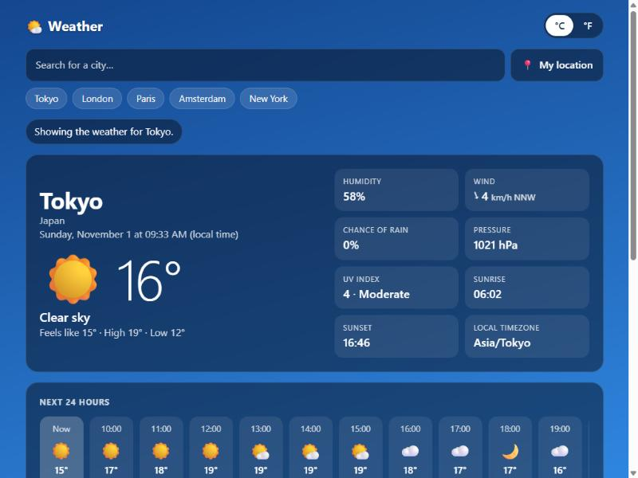

# Weather App

A fast, good-looking weather app: search any city and get the current conditions, the next 24 hours and a 7-day forecast.

**Live demo:** https://weather-app-beta-gules-95.vercel.app



## Features

- **Search with suggestions** - results show the region and country, so "Paris, France" and "Paris, Texas" are easy to tell apart. Works with the keyboard (arrow keys, Enter, Escape).
- **Current weather** - temperature, feels-like, conditions, humidity, wind speed and direction, chance of rain, pressure, UV index, sunrise and sunset, and the city's local time.
- **Next 24 hours** and **7-day forecast** with a temperature range for each day.
- **My location** button (the browser asks for permission first).
- **°C / °F switch** - converts instantly and is remembered.
- **Remembers** your last city and your recent searches.
- **Changes with the weather** - the background follows the conditions and day or night (clear, cloudy, rain, storm, snow, fog).
- **Helpful messages** when a city isn't found or the connection drops, with a "Try again" button.
- Responsive, keyboard friendly, screen-reader labels, and respects "reduce motion".
- Refreshes itself every 15 minutes while the page is open.

## Built with

Plain HTML, CSS and JavaScript. No framework, no build step, and **no API key** - the data comes from the free [Open-Meteo](https://open-meteo.com/) weather and geocoding APIs.

## Run it locally

Open `index.html` in your browser, or serve the folder:

```bash
python -m http.server 8000
```

then visit http://localhost:8000.

## Credits

Weather data by [Open-Meteo.com](https://open-meteo.com/) (licensed [CC BY 4.0](https://creativecommons.org/licenses/by/4.0/)). Open-Meteo's free service is for non-commercial use.

Made by [Cublex01](https://github.com/Cublex01).
